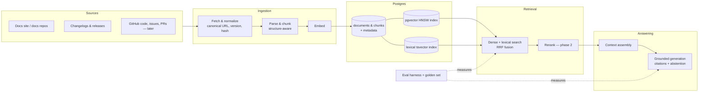

# langstack-knowledge-engine
RAG knowledge engine for LangChain and LangGraph, ingesting docs, repositories, issues, and other sources into a searchable vector-backed knowledge base for grounded agent context, retrieval, and experimentation.

## Plan (living doc — will change a lot)

**Approach:** Postgres + pgvector as the single store (vectors, lexical/tsvector index, metadata, job state). Hybrid retrieval (dense + lexical, fused) from day one, not dense-only — the corpus is API docs full of exact identifiers that lexical search catches and embeddings miss. Structure-aware chunking that never splits a code fence from its lead-in prose. An eval harness (golden question set + metrics) built alongside the pipeline, not after it, so every design decision is measured rather than assumed.

**Phased roadmap:**
| Phase | Focus |
|---|---|
| 0 | Walking skeleton — minimal corpus, ingestion, retrieval, and eval, end to end |
| 1 | Corpus breadth — full LangChain + LangGraph docs, changelogs |
| 2 | Retrieval depth — reranking, contextual prefixes, parent-child expansion |
| 3 | Write infra ops — scheduled sync, freshness tracking |
| 4 | Corpus breadth — code examples, GitHub issues/PRs (with injection defenses) |
| 5 | Interfaces — MCP server for agent consumers |
| 6 | Hardening — multi-provider models, scale |

**Big picture (target end state, not built yet):**


**Status:** Phase 0 is roughly half done: ingestion (parse → structure-aware chunking → BGE-M3 embeddings → pgvector), hybrid retrieval (dense + sparse + full-text, RRF-fused, metadata-filtered), and the retrieval eval harness are implemented and tested. Not yet built: the grounded answer composer (#9), injection defenses (#11), the first real baseline numbers (#12), reranking, and the docs/GitHub fetchers. See [docs/ROADMAP.md](docs/ROADMAP.md) for issue-by-issue status.

**Docs:** [Architecture & decisions](docs/ARCHITECTURE.md) · [Evaluation](docs/EVALUATION.md) · [Development guide](docs/DEVELOPMENT.md) · [Roadmap](docs/ROADMAP.md)

### Local dev setup
```
uv sync --dev                  # add `--extra bge` for the real BGE-M3 embedder (pulls torch)
cp .env.example .env
docker compose up -d           # Postgres 16 + pgvector 0.8
uv run pytest                  # integration tests skip if Postgres isn't reachable

uv run lkengine ingest         # index the shipped corpus (idempotent)
uv run lkengine search "why does my graph hang?" --product LangGraph both
uv run lkengine eval           # Recall@k / MRR against the golden set
```
Use `--embedder hash` on any command for a dependency-free smoke run (no model download; results are not representative).
