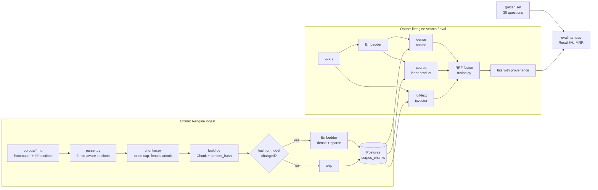

# Architecture

This document explains what the engine does, how the code is organised, and —
more importantly — **why** it is built this way. It describes what exists on
this branch (the Phase 0 walking skeleton up to retrieval + evaluation); the
roadmap for the rest is in [ROADMAP.md](ROADMAP.md).

## 1. The problem and the shape of the solution

The corpus is LangChain/LangGraph documentation: short, self-contained
sections, dense with exact identifiers (`InvalidUpdateError`,
`wrap_model_call`, `langgraph.json`). A plain embedding search blurs exact
identifiers; a plain keyword search misses paraphrase ("why does my graph
hang?"). So the engine is a **hybrid retrieval** system with a measured
(evaluated) feedback loop:



Not built yet (see roadmap): reranker (#20), answer composer with citations and
abstention (#9), prompt-injection hardening (#11/#28), MCP server (#31),
docs/GitHub fetchers (#5, #13, #26+).

## 2. Code map

```
src/lkengine/
  models.py            CorpusDocument / Section / Chunk (frozen dataclasses)
  paths.py             where the shipped corpus, golden set and schema live
  ingest/
    parser.py          file -> document + sections        (pure)
    chunker.py         section -> size-capped parts       (pure)
    build.py           parsed docs -> Chunks + xrefs      (pure)
    pipeline.py        the only ingest code that touches the DB
  embed/
    base.py            Embedder protocol, Embedding        <- the seam
    hashing.py         deterministic fake (tests, CI, smoke runs)
    bge.py             BAAI/bge-m3 adapter (optional extra)
  db/
    schema.sql         tables + indexes (dimensions are placeholders)
    migrate.py         idempotent apply, dimension guard, opt-in HNSW
    store.py           the SQL: state, upsert, refresh, prune
    vectors.py         python -> pgvector literals
  retrieval/
    fusion.py          weighted RRF                        (pure)
    hybrid.py          HybridRetriever: 3 channels + fusion + xref expansion
  eval/
    golden.py          load + validate the golden set      (pure)
    metrics.py         recall/hit/reciprocal-rank          (pure)
    harness.py         run a retriever over the set, aggregate (pure)
  cli.py               lkengine db|ingest|search|eval
  corpus/              the knowledge itself (markdown) + reference scripts
```

The rule that makes this testable: **everything marked "pure" has no database
and no model**, so it is unit-tested in milliseconds. Only `pipeline.py`,
`store.py`, `migrate.py` and `hybrid.py` need Postgres, and they are covered by
integration tests that get a private schema per test.

## 3. Data model

| Level | Type | Identity | Purpose |
|---|---|---|---|
| Document | `CorpusDocument` | `doc_id` (`LG-04`) | provenance: tier, version scope, last-verified, source path, (later) URL + license |
| Section | `Section` | `section_id` (`LG-04.3`) | **the citable unit** — what the golden set labels and what answers will cite |
| Chunk | `Chunk` | `chunk_id` (`LG-04.3`, `LG-04.3~2`) | what we embed and retrieve |

A section is normally one chunk. It becomes several only when it exceeds the
token cap; part 1 keeps the bare `section_id` as its `chunk_id` so ids stay
stable when a section grows. Evaluation and citation always collapse parts back
to `section_id`.

Authority tiers (from the corpus frontmatter): **1** primary/official,
**2** corroborated secondary, **3** single-source. They are stored and
filterable (`max_tier`) so retrieval can prefer — and the future composer can
caveat — weaker evidence.

`canonical_url` and `license` columns exist but are `NULL` for the shipped
corpus (its frontmatter doesn't carry them); the Phase 1 fetchers populate them.

## 4. Ingestion

1. **Parse** (`parser.py`). Frontmatter → `CorpusDocument`; body → sections.
   Splitting is *fence-aware*: a `## comment` line inside a ``` block is not a
   heading. Files without frontmatter (READMEs) are skipped; frontmatter that is
   present but incomplete is a hard error rather than a silent skip.
2. **Chunk** (`chunker.py`). Heading-bounded; token-capped (default 480 ≈ the
   512-token cross-encoder budget minus room for the query); a code fence is
   atomic and keeps its lead-in paragraph. Token counts use `words × 1.4`, a
   deliberate heuristic so chunking has no model dependency.
3. **Build** (`build.py`). `content = "# <doc title>\n\n" + body` is what gets
   embedded. Prepending the title gives the encoder document context for
   free — the cheap deterministic version of "contextual retrieval"
   (Anthropic's technique of LLM-written chunk prefixes; spike #21 will measure
   whether the expensive version beats this).
4. **Index** (`pipeline.py`). Only chunks whose `content_hash` *or*
   `embedding_model` differ from the stored values are embedded. Rerunning on
   an unchanged corpus embeds **zero** chunks; a one-paragraph edit embeds one;
   a model swap re-embeds all. Metadata-only edits (tier, tags) update the row
   without re-embedding. Chunks that disappeared from the corpus are deleted
   (hard delete — soft tombstones and per-source incremental sync are #23).
   `META` housekeeping documents are stored for provenance but **not embedded**
   and never retrieved.

## 5. Retrieval

`HybridRetriever.search(query, filters, top_k)`:

1. Encode the query once → dense + sparse vectors.
2. Run three **independently filtered** channels, each returning its top
   `pool` (40) chunk ids:
   - **dense** — cosine distance on `vector`; captures meaning/paraphrase.
   - **sparse** — inner product on BGE-M3's learned lexical weights
     (`sparsevec`); captures literals without a separate BM25 index. Rows with
     zero token overlap are excluded, otherwise they'd enter the fusion as noise.
   - **full-text** — Postgres `websearch_to_tsquery`; weight 0.5 because it
     overlaps the sparse channel but is free and catches literals the learned
     model down-weights.
3. **Fuse with weighted Reciprocal Rank Fusion**: `score = Σ w_c / (60 + rank_c)`.
   RRF uses ranks, not scores, because cosine, inner product and `ts_rank_cd`
   are incomparable scales. A chunk that several channels rank well beats one
   that a single channel loves.
4. Hydrate the top-k with provenance (`section_id`, tier, version scope,
   last-verified, per-channel ranks for explainability).

`expand_xrefs` optionally adds the `.1` overview section of every document the
top hits explicitly cite (the corpus writes `` `LG-04` `` instead of "see
above", so this is mechanical and precise).

**Filters** (`product`, `series`, `max_tier`) are applied inside every channel
(pre-filter). A `product=LangGraph` query is therefore never diluted by
LangChain results. Note `max_tier` excludes rows with no tier.

## 6. Key decisions and trade-offs

| Decision | Why | Revisit when |
|---|---|---|
| **Exact vector scan, HNSW opt-in** (`lkengine db init --ann`) | At ~200–few-thousand chunks an exact scan is sub-ms with 100% recall; HNSW adds build cost and *approximate* recall. Tickets #7/#8 mention HNSW — it is implemented but off by default. | ~100k chunks (Phase 1 full docs, Phase 4 GitHub). Beware: pgvector applies HNSW *before* metadata filters, so selective filters can under-return; see `create_ann_index` docstring. |
| **Fuse in Python, 3 small queries** | One mega-CTE (as in the reference `corpus/rag/search.py`) is unreadable and untestable; here fusion is a pure, unit-tested function. | Latency profiling says round trips matter (unlikely at this scale). |
| **`section_id` is the citation/eval unit, not `chunk_id`** | Users and golden labels think in sections; chunking is an implementation detail that may change. | — |
| **Embedder behind a Protocol** | Fast tests, and the embedding bake-off (#17) becomes "implement one class". | — |
| **Dimensions in schema, guarded** | Vector widths are baked into column types. `engine_meta` records them; a mismatch fails fast with an actionable message instead of a cryptic pgvector error. | — |
| **Sparse indices shifted +1** | pgvector `sparsevec` is 1-indexed; model token ids are 0-indexed. One function (`vectors.sparse_literal`) does the shift for both ingest and query so they cannot disagree. (The reference script passed raw ids.) | — |
| **META not embedded** | Saves compute; removes the only sections that exceed the reranker budget; they answer no user question. | — |
| **Pre-filtered channels + score-free fusion** | Avoids cross-scale score normalisation bugs. | A learned fusion beats RRF in eval. |

## 7. Known limitations (honest list)

- The real **BGE-M3 adapter has not been run in CI or in the authoring
  environment** (no model download). It is thin and mirrors the reference
  implementation; the first real ingest is its integration test. Everything
  else is exercised against a real Postgres + pgvector 0.8.
- The baseline retrieval numbers (#12) are therefore **not yet published**. The
  numbers you see from `--embedder hash` are a lexical fake and only validate
  the plumbing.
- Oversized *non-code* paragraphs are not split mid-paragraph (rare; the corpus
  has none above the cap for retrievable sections). Oversized fences are
  emitted whole by design.
- No reranker, no answer generation, no prompt-injection defences yet — do not
  expose this to untrusted content until #11/#28 land.
- Hard-delete pruning, not tombstones (#23).

## 8. Extending

- **New embedding model**: implement `Embedder` (`model_id`, `dense_dim`,
  `sparse_dim`, `encode`), register in `embed/__init__.py`, re-ingest after
  `lkengine db reset` if dimensions differ, run `lkengine eval`.
- **New retrieval channel**: add a SQL entry to `_CHANNEL_SQL`, a weight in
  `DEFAULT_WEIGHTS`; fusion needs no change.
- **Reranker (#20)**: wrap `HybridRetriever.search` — take the fused `pool`
  and reorder; gate on an eval-measured flag.
- **New source (docs repo, GitHub)**: produce `(CorpusDocument, [Section])`
  pairs and feed `build_chunks`; everything downstream is source-agnostic.
